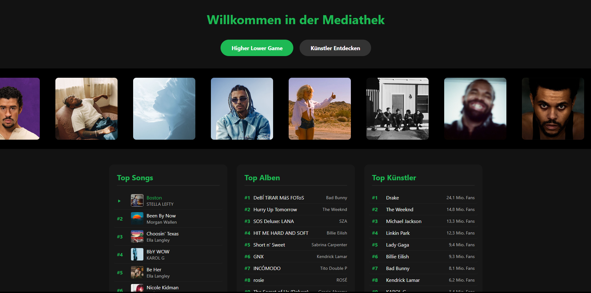
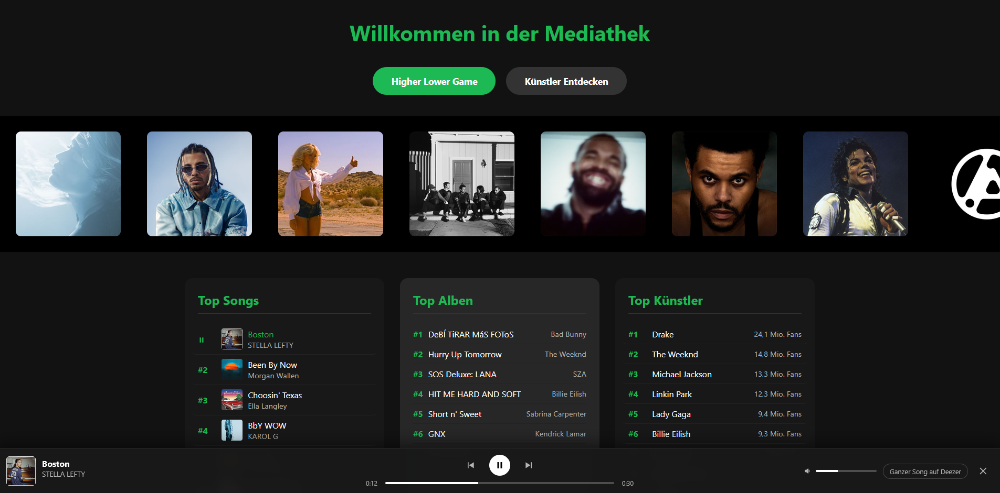
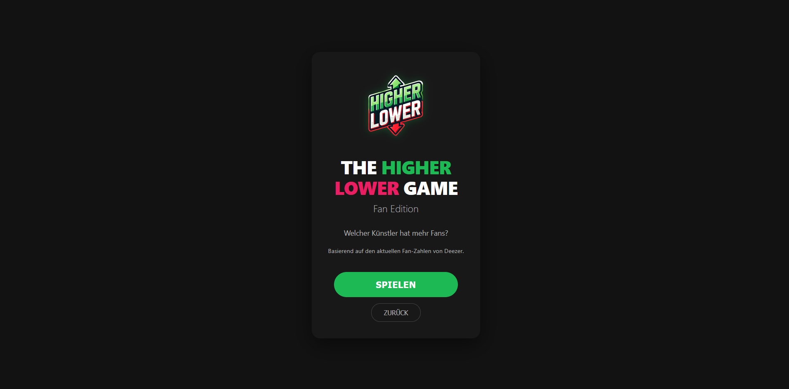
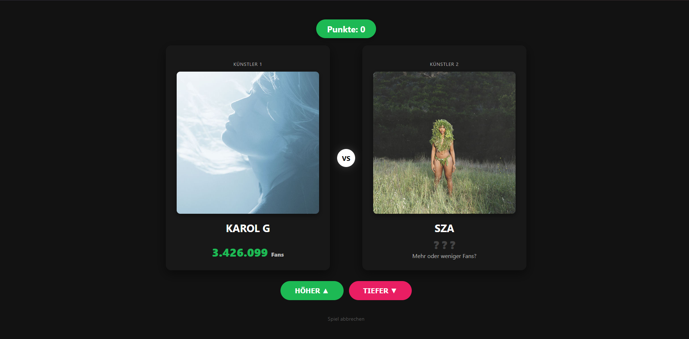
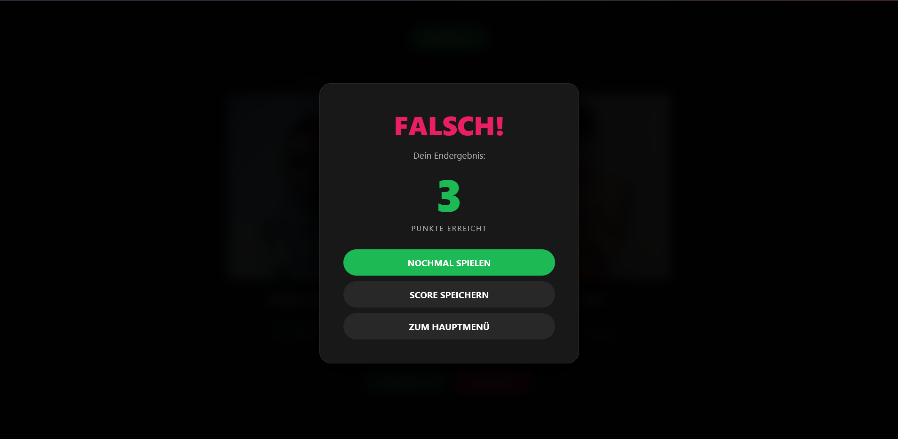
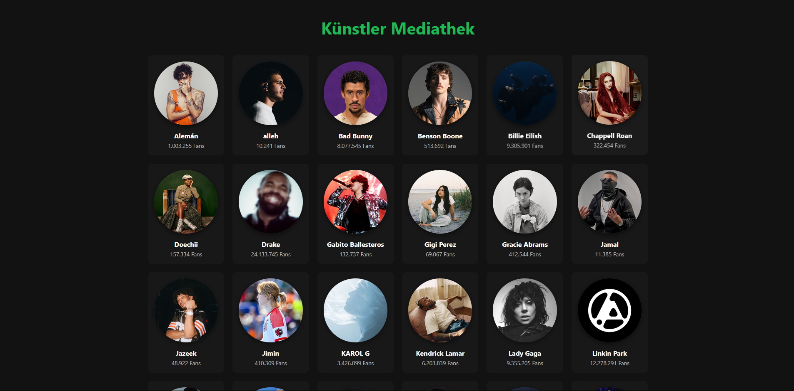
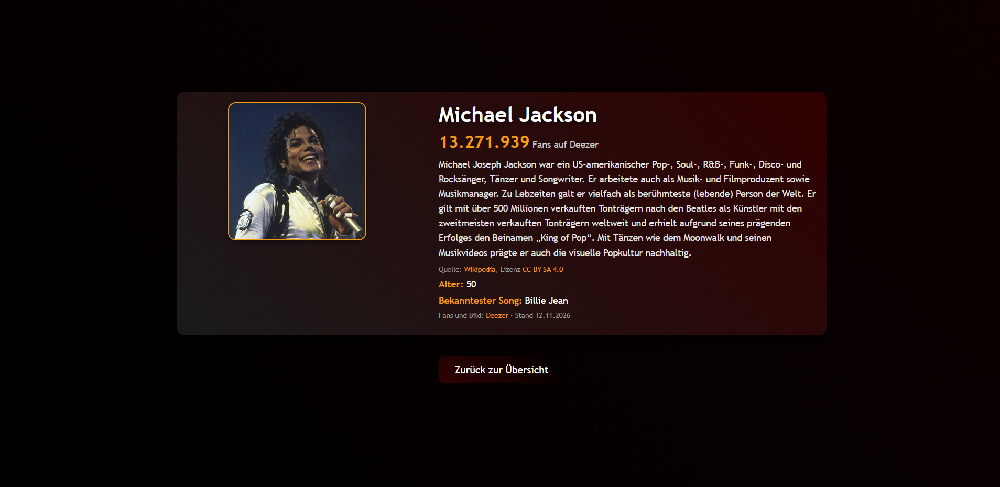

# Artist Quiz – Higher Lower Game

Ein Web-Spiel über Musik-Künstler: Du rätst, welcher von zwei Künstlern mehr Fans hat. Dazu gibt es eine Künstler-Übersicht mit Detailseiten und aktuelle Charts, deren Songs man direkt auf der Startseite anhören kann. Das Projekt läuft auf einem normalen PHP-Webserver.

**Live:** [artistquiz.rf.gd](https://artistquiz.rf.gd/) (gehostet bei InfinityFree)

## Vorschau

| Startseite | Song-Player |
| :---: | :---: |
|  |  |
| Higher Lower Game | Vergleich im Spiel |
|  |  |
| Game Over | Künstler |
|  |  |
| Künstler-Detailseite | |
|  | |

## Funktionen

* Higher Lower Game: Zwei zufällige Künstler werden nach ihren Deezer-Fan-Zahlen verglichen. Jede richtige Antwort gibt einen Punkt.
* Nach dem Spiel kann man seinen Score im Leaderboard speichern.
* Die Künstler-Übersicht zeigt jeden Künstler mit Bild und Fan-Zahl. Jede Karte führt zur Detailseite (`artist.php?id=N`) mit einer Kurzbeschreibung.
* Ein Klick auf einen der Top Songs der Startseite öffnet unten eine Player-Leiste mit der 30-Sekunden-Vorschau von Deezer. Der Player kann vor- und zurückspringen, spulen und die Lautstärke regeln, spielt danach automatisch den nächsten Song und reagiert auf die Leertaste.
* Die Startseite zeigt die Top Songs aus den weltweiten Deezer-Charts und die Künstler mit den meisten Fans. Künstler in der Liste und im Karussell führen zur Detailseite.
* Dunkles Design im Stil von Spotify, das auch auf Smartphone und Tablet funktioniert.

## Technik

* PHP 8, HTML, CSS, JavaScript
* MySQL/MariaDB für Künstler, Charts und Leaderboard; die Datenbank dient auch als Cache für die API-Daten
* Deezer- und Wikipedia-API, per cURL und ohne API-Schlüssel (siehe Datenquellen)
* Sicherheit: Prepared Statements, CSRF-Schutz und Spiellogik auf dem Server. Die Fan-Zahl des zweiten Künstlers steht nie im HTML. Die Zugangsdaten liegen außerhalb des Repositorys.

## Lokal einrichten (XAMPP)

1. Projekt nach `C:\xampp\htdocs\artist1` klonen und in XAMPP Apache und MySQL starten.
2. In phpMyAdmin eine Datenbank `projektm` anlegen und `projektm.sql` sowie `higher_lower.sql` importieren.
3. Die Migrationen aus `db/migrations/` der Reihe nach importieren:
   `001_normalize_artists.sql`, `002_cleanup.sql`, `003_external_api.sql`, `004_bio_updated_at.sql`, danach `005_api_cache.sql`.
4. `config.example.php` nach `config.php` kopieren und die Zugangsdaten eintragen.
   `config.php` kommt nicht ins Repository.
5. Im Browser `http://localhost/artist1/` öffnen.

## Datenquellen

* [Deezer API](https://developers.deezer.com/api): Künstlerbilder (`picture_xl`) und Fan-Zahlen (`nb_fan`). Auf der Startseite außerdem die Top Songs aus der Playlist „Top Worldwide“ (täglich aktualisiert) und die Künstler mit den meisten Fans.
  Die 30-Sekunden-Vorschauen lädt `preview.php` erst beim Abspielen, weil Deezer die MP3-Links nur etwa 15 Minuten lang gültig signiert.
* [Wikipedia REST API](https://de.wikipedia.org/api/rest_v1/): Kurzbeschreibungen der Künstler, zuerst aus der deutschen, sonst aus der englischen Wikipedia. Die Texte stehen unter [CC BY-SA 4.0](https://creativecommons.org/licenses/by-sa/4.0/deed.de); jede Detailseite verlinkt den Artikel.

Die Künstlerdaten werden in der Tabelle `artists` gespeichert und erst nach 7 Tagen neu abgerufen (`artist_api.php`). Die Top Songs der Startseite bleiben 24 Stunden in der Tabelle `api_cache`. Ist eine API nicht erreichbar, zeigt die Seite die zuletzt gespeicherten Daten oder das lokale Bild aus `image/`.
Die Deezer-IDs stehen fest in `003_external_api.sql`. Bei mehrdeutigen Namen legt die Spalte `wiki_title` den Wikipedia-Artikel fest (z. B. `de:Lalisa Manobal`).

## Team

Gruppenprojekt aus der Ausbildung:

* Saltuk Kalender: Song-Player, später die Überarbeitung des ganzen Projekts
* Chris: Higher Lower Game
* Yuki: Startseite

*Fan-Projekt zu Lernzwecken, ohne Verbindung zu Spotify, Deezer oder Wikipedia.*
