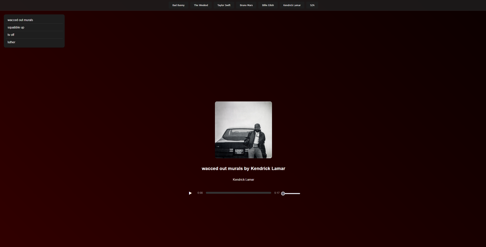

# 🎵 Spotify Higher Lower Game

Ein interaktives Web-Spiel basierend auf Spotify-Streaming-Daten. Teste dein Wissen darüber, welcher Künstler mehr Streams hat! Dazu gibt es eine Künstler-Übersicht und einen Music Player. Das Projekt ist für die Ausführung auf PHP-basierten Webservern optimiert.

## 🚀 Live Demo

Das Spiel ist online über **InfinityFree** erreichbar:

👉 [**ZUM LIVE-SPIEL**](https://artistquiz.rf.gd/)

## 📸 Preview

| Startseite | In-Game Vergleich |
| :---: | :---: |
|  |  |
| **Künstler** | **Music Player** |
|  |  |

## 🎮 Features

* **Higher Lower Game:** Vergleiche zwei zufällig gewählte Künstler aus der Datenbank und sammle Punkte für jede richtige Antwort.
* **Leaderboard:** Speichere deinen Score nach dem Spiel und vergleiche dich mit anderen.
* **Künstler-Mediathek:** Eine Übersicht aller im Spiel enthaltenen Künstler mit Detailseiten.
* **Music Player:** Songs ausgewählter Künstler direkt im Browser abspielen.
* **Spotify Design:** Modernes Dark-Mode Interface im typischen Spotify-Stil.
* **Responsive Layout:** Funktioniert auf Smartphones, Tablets und Desktop-PCs.

## 🛠️ Technische Details

* **Sprachen:** PHP 8.x, HTML5, CSS3, JavaScript.
* **Datenbank:** MySQL/MariaDB für Künstler, Streams, Charts und Leaderboard.
* **Hosting:** Veröffentlicht via InfinityFree Webhosting.
* **Sicherheit:** Prepared Statements, CSRF-Schutz, serverseitige Spiellogik, Zugangsdaten außerhalb des Repositorys.

## ⚙️ Lokal einrichten (XAMPP)

1. Projekt nach `C:\xampp\htdocs\artist1` klonen und in XAMPP **Apache** und **MySQL** starten.
2. In phpMyAdmin eine Datenbank `projektm` anlegen und `projektm.sql` sowie `higher_lower.sql` importieren.
3. Die Migrationen aus `db/migrations/` der Reihe nach importieren:
   `001_normalize_artists.sql`, danach `002_cleanup.sql`.
4. `config.example.php` nach `config.php` kopieren und die Zugangsdaten eintragen.
   `config.php` wird **nicht** ins Repository übernommen.
5. Im Browser `http://localhost/artist1/` öffnen.

## 👥 Projekt-Team

Dieses Projekt ist als Gruppenprojekt entstanden:

* **Saltuk Kalender**: Music Player sowie spätere Überarbeitung und Verbesserungen
* **Chris**: Higher Lower Game
* **Yuki**: Startseite

---
*Hinweis: Dies ist ein Fan-Projekt zu Bildungszwecken und steht in keiner offiziellen Verbindung zu Spotify.*
